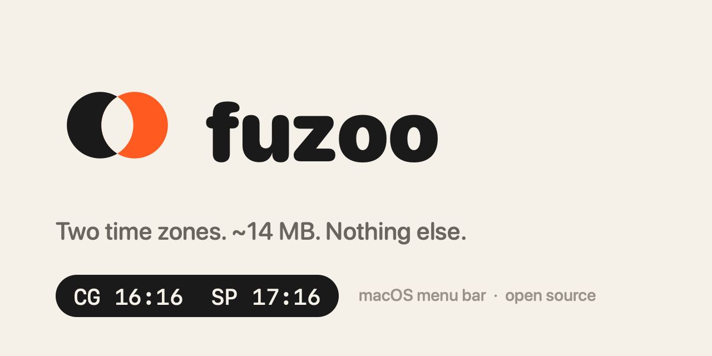

<p align="center">
  
</p>

<p align="center">
  <b>Two time zones in your menu bar. ~8.5 MB of RAM observed. Nothing else.</b><br>
  <a href="https://oisergiofelix.github.io/fuzoo/">Website</a> ·
  <a href="https://oisergiofelix.github.io/fuzoo/roadmap.html">Roadmap</a> ·
  <a href="https://github.com/oisergiofelix/fuzoo/releases/latest/download/fuzoo.dmg">Download for macOS</a> ·
  <a href="README.pt-BR.md">Português</a>
</p>

<p align="center">
  
  
  
</p>

---

## Why

I work remotely from Campo Grande, one hour behind São Paulo. Every meeting invite, every deadline, every "talk at 3?" meant doing the math in my head, all day long.

The world-clock apps I found did a lot more than I needed and cost a lot more memory than a clock should. I wanted the opposite: two times in the menu bar, and a process so small I'd forget it was running.

So I built **fuzoo**.

```
CG 16:16  SP 17:16
```

It ships with Campo Grande and São Paulo. Swap them, add more, or rename the labels from the menu.

Turn on **Show date → Short** to add your Mac’s local date to the bar:

```
Tuesday, Nov 10 · CG 16:16 · SP 17:16
```

## AI usage limits

Choose **Connect AI usage limits…**, then select Codex, Claude, or both. It adds a
separate item such as `Codex 92% · Claude 81%`: **remaining in the current
session**. Click for weekly balances, reset time, and reading age.

The connection is explained before its first query. It uses only the existing
Codex login and/or Claude session, never saves, displays, or forwards tokens.
**Connect or repair Claude…** handles a needed macOS Keychain authorization.
No Accessibility permission is required. Each provider is queried at most once a
minute; failures or service pauses slow future retries. Unavailable, expired, or
stale balances appear as `—`. The usage endpoints are internal and can change.

On a new installation: enable the item, select providers, and verify the first
balance. If Claude is unavailable, use **Connect or repair Claude…**, allow the
Keychain prompt, and close the confirmation. The app verifies a silent read before
calling the session usable.

## How small

The measurements below are v0.5.0 development observations with optional
features off. Optional features have a cost only while enabled.

| | fuzoo |
|---|---|
| Memory (`phys_footprint`) | **~8.5 MB observed** |
| CPU while idle | **0.0% observed** with the monitor off |
| Release download | **~190 KB**, universal binary |
| Dependencies | **none** |
| Source | Native Objective-C / AppKit, no third-party dependencies |

The memory and CPU figures are observations from the development Mac with the date enabled, the optional monitor off, and fuzoo idle. A small comparison with the same clock written in plain C, calling the Objective-C runtime by hand, used slightly more memory. Most of the footprint comes from AppKit and the WindowServer connection; fuzoo's own code is only a few kilobytes.

### What keeps it tiny

- **One wake-up per minute.** A wall-clock timer fires exactly when the minute turns, and stays correct across sleep and wake. A 1-second tolerance lets macOS batch it with other work.
- **No date formatters.** The time is plain arithmetic on the zone's UTC offset.
- **Real time zones.** IANA identifiers (`America/Campo_Grande`), so daylight saving and rule changes come from macOS itself.
- **A lazy menu.** It's built only when you click.
- **An optional Mac monitor.** When off, it has no status item, timer, or memory-pressure source. When on, it samples the whole system every 30 seconds — never processes individually. Text stays native to the menu bar; color is only a semantic accent in the bars or status dot.
- **Native UI.** AppKit, without an embedded browser. The optional AI helper runs briefly for each refresh, then exits.

## Install

1. [Download `fuzoo.dmg`](https://github.com/oisergiofelix/fuzoo/releases/latest/download/fuzoo.dmg) and drag **fuzoo** into **Applications**.
2. fuzoo isn't notarized by Apple (yet), so the first launch is blocked. Allow it in one of two ways:
   - **System Settings → Privacy & Security** → scroll down → **Open Anyway**, or
   - in Terminal:
     ```bash
     xattr -dr com.apple.quarantine /Applications/fuzoo.app
     ```
3. Click the clock → **Open at login**.
4. **Tip:** your Mac's own clock already shows your local time. To avoid seeing it twice, set it to analog: **System Settings → Control Center → Clock → Clock Options → Analog**. fuzoo then becomes the only digital time in your menu bar.

macOS controls the order of menu-bar items. To place fuzoo where you prefer, hold **⌘** and drag it; macOS remembers the position.

Prefer to build it yourself? You only need the Command Line Tools (`xcode-select --install`):

```bash
git clone https://github.com/oisergiofelix/fuzoo && cd fuzoo && make install
```

### Signing and updates

Local builds are ad-hoc signed and may need a new Keychain confirmation when the
helper binary changes. Production distribution will use one **Developer ID
Application** certificate, hardened runtime, signing for every nested executable,
and Apple notarization. That stable identity — not a code trick — is what lets
Keychain recognize the helper across updates. `make production-check
SIGN_IDENTITY="Developer ID Application: …"` prevents an accidental ad-hoc
distribution.

## Use

Click the clock in the menu bar:

- **Each clock** → pick a city, choose **Other time zone…** (any IANA zone), **Rename label…**, or **Remove**
- **Add clock**
- **Show date** → Off or Short. The menu always shows the full local date.
- **Mac monitor** → optionally show a separate health item: `Mac ok · ▁▂▁▃▂▁`. It samples only while visible; its own menu shows CPU, approximate memory, and memory pressure.
- **Open at login**
- **Public roadmap**

The interface follows your system language (English or Portuguese).

Prefer the terminal? Edit the clocks directly, then relaunch:

```bash
defaults write io.github.oisergiofelix.fuzoo clocks -array \
  '{label=CG;tz="America/Campo_Grande";}' '{label=SP;tz="America/Sao_Paulo";}'
```

## Develop

```bash
make run       # build and open
make release   # build/fuzoo.dmg + build/fuzoo.zip
make brand     # regenerate icon and images from tools/brand.m
make clean
```

Pushing a `v*` tag builds and publishes a release via GitHub Actions.

Contributions are welcome. One rule: **fuzoo must not get heavier.** If a feature costs memory or wake-ups while the menu is closed, it probably doesn't belong here.

## License

[MIT](LICENSE) © Sérgio Felix
