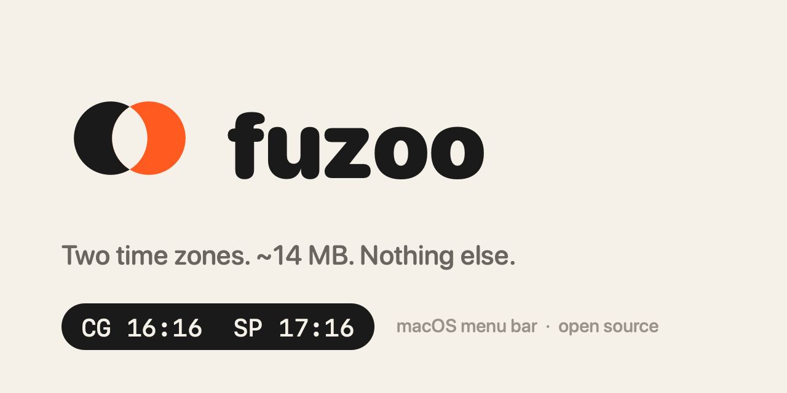

<p align="center">
  
</p>

<p align="center">
  <b>Dois fusos na barra de menus. ~8,5 MB de RAM observados. Mais nada.</b><br>
  <a href="https://oisergiofelix.github.io/fuzoo/">Site</a> ·
  <a href="https://oisergiofelix.github.io/fuzoo/roadmap.html">Roadmap</a> ·
  <a href="https://github.com/oisergiofelix/fuzoo/releases/latest/download/fuzoo.dmg">Baixar para macOS</a> ·
  <a href="README.md">English</a>
</p>

---

## Por quê

Trabalho remoto de Campo Grande, uma hora atrás de São Paulo. Todo convite de reunião, todo prazo, todo "falamos às 15h?" virava uma conta de cabeça, o dia inteiro.

Os relógios mundiais que encontrei faziam muito mais do que eu precisava e gastavam muito mais memória do que um relógio deveria. Eu queria o contrário: dois horários na barra de menus e um processo tão pequeno que eu esquecesse que ele está rodando.

Daí nasceu o **fuzoo**.

```
CG 16:16  SP 17:16
```

Ele vem com Campo Grande e São Paulo. Pelo menu você troca, adiciona ou renomeia os relógios.

Ligue **Mostrar data → Curta** para colocar a data local do Mac na barra:

```
Terça, 10 nov · CG 16:16 · SP 17:16
```

## Limites de IA

Escolha **Conectar limites de IA…** e selecione Codex, Claude ou ambos. O fuzoo mostra,
em um item separado, com ícones locais dos apps e números, por exemplo `[Codex] 92 : [Claude] 81`: o **saldo restante da
sessão atual**. Se os ícones não estiverem disponíveis, aparecem os nomes. Clique para ver blocos informativos com a semana, o reset e a idade de cada leitura.

A conexão é explicada antes da primeira consulta. Ela usa somente o login já
existente do Codex e/ou a sessão do Claude, sem salvar, exibir ou encaminhar
tokens. **Conectar ou reparar Claude…** trata a autorização do Chaves quando ela
for necessária. Não precisa de Acessibilidade. Cada provedor é consultado no
máximo uma vez por minuto; uma falha ou pausa aumenta apenas as tentativas futuras.
Saldo indisponível, expirado ou antigo aparece como `—`. Os endpoints são internos
e podem mudar.

Para uma instalação nova: ative o item, selecione os provedores e confira o
primeiro saldo. Se Claude ficar indisponível, clique em **Conectar ou reparar
Claude…**, permita o acesso solicitado pelo Chaves e feche a confirmação. O app
verifica a leitura silenciosa antes de considerar a sessão utilizável.

## Quão pequeno

As medições abaixo são observações de desenvolvimento da v0.5.0, com os recursos
opcionais desligados. Os recursos opcionais têm custo somente quando ligados.

| | fuzoo |
|---|---|
| Memória (`phys_footprint`) | **~8,5 MB observados** |
| CPU em repouso | **0,0% observado** com o monitor desligado |
| Download da release | **~190 KB**, binário universal |
| Dependências | **nenhuma** |
| Código | Objective-C / AppKit nativo, sem dependências de terceiros |

Os números de memória e CPU são observações no Mac de desenvolvimento, com a data ativada, o monitor opcional desligado e o fuzoo em repouso. Em uma comparação pequena, o mesmo relógio reescrito em C puro, chamando o runtime do Objective-C na mão, gastou levemente *mais*. A maior parte vem do AppKit e da conexão com o WindowServer; o código do fuzoo em si ocupa poucos KB.

### O que deixa ele tão pequeno

- **Acorda uma vez por minuto.** Um timer de relógio de parede dispara exatamente na virada do minuto e continua certo depois que o Mac dorme e acorda. A tolerância de 1 s deixa o macOS agrupar esse despertar com outros.
- **Sem formatadores de data.** A hora é aritmética pura sobre o offset UTC do fuso.
- **Fusos de verdade.** Identificadores IANA (`America/Campo_Grande`), então horário de verão e mudanças de regra vêm do próprio macOS.
- **Menu preguiçoso.** Ele só é montado quando você clica.
- **Monitor do Mac opcional.** Desligado, ele não tem item de barra, timer nem fonte de pressão de memória. Ligado, amostra o sistema inteiro a cada 30 segundos — nunca processos individuais. O texto conserva a cor nativa da barra; cor é somente um reforço semântico nas barrinhas ou no ponto de status.
- **Interface nativa.** AppKit, sem navegador embutido. O conector opcional de IA executa por pouco tempo em cada consulta e encerra.

## Instalar

1. [Baixe o `fuzoo.dmg`](https://github.com/oisergiofelix/fuzoo/releases/latest/download/fuzoo.dmg) e arraste o **fuzoo** para **Aplicativos**.
2. O fuzoo ainda não é notarizado pela Apple, então o macOS bloqueia a primeira abertura. Libere de um destes jeitos:
   - **Ajustes do Sistema → Privacidade e Segurança** → role até o fim → **Abrir Mesmo Assim**, ou
   - no Terminal:
     ```bash
     xattr -dr com.apple.quarantine /Applications/fuzoo.app
     ```
3. Clique no relógio → **Iniciar com o sistema**.
4. **Dica:** o relógio do próprio Mac já mostra a sua hora local. Para não vê-la duas vezes, deixe-o analógico: **Ajustes do Sistema → Central de Controle → Relógio → Opções do Relógio → Analógico**. Aí o fuzoo vira a única hora digital da barra.

O macOS controla a ordem dos itens da barra. Para colocar o fuzoo onde preferir, segure **⌘** e arraste; o macOS lembra a posição.

Prefere compilar? Só precisa do Command Line Tools (`xcode-select --install`):

```bash
git clone https://github.com/oisergiofelix/fuzoo && cd fuzoo && make install
```

### Assinatura e atualizações

Builds locais são assinados ad hoc e podem precisar de uma nova confirmação do
Chaves quando o binário do conector muda. A release de produção usará um único
certificado **Developer ID Application**, com runtime endurecido, assinatura de
todos os executáveis internos e notarização da Apple. É essa identidade estável —
e não um truque de código — que permite ao Chaves reconhecer o conector entre
atualizações. `make production-check SIGN_IDENTITY="Developer ID Application: …"`
impede por engano uma distribuição ad hoc.

## Usar

Clique no relógio na barra de menus:

- **Cada relógio** → escolha uma cidade, **Outro fuso…** (qualquer fuso IANA), **Renomear rótulo…** ou **Remover**
- **Adicionar relógio**
- **Mostrar data** → Desligada ou Curta. O menu sempre mostra a data local completa.
- **Monitor do Mac** → mostra opcionalmente um item separado de saúde: `Mac ok · ▁▂▁▃▂▁`. Ele só amostra enquanto está visível; seu menu mostra CPU, memória aproximada e pressão de memória.
- **Conectar limites de IA…** → escolha Codex, Claude ou ambos. O item só aparece após a conexão; mostra o saldo atual, o reset e alertas discretos quando uma cota está baixa.
- **Iniciar com o sistema**
- **Roadmap público**

A interface segue o idioma do sistema (português ou inglês).

Prefere o terminal? Edite os relógios direto e reabra o app:

```bash
defaults write io.github.oisergiofelix.fuzoo clocks -array \
  '{label=CG;tz="America/Campo_Grande";}' '{label=SP;tz="America/Sao_Paulo";}'
```

## Desenvolver

```bash
make run       # compila e abre
make release   # build/fuzoo.dmg + build/fuzoo.zip
make brand     # regenera ícone e imagens a partir de tools/brand.m
make clean
```

Uma tag `v*` gera e publica a release pelo GitHub Actions.

Contribuições são bem-vindas. Uma regra: **o fuzoo não pode ficar mais pesado.** Se um recurso gasta memória ou acorda o processo com o menu fechado, provavelmente ele não pertence aqui.

## Licença

[MIT](LICENSE) © Sérgio Felix
